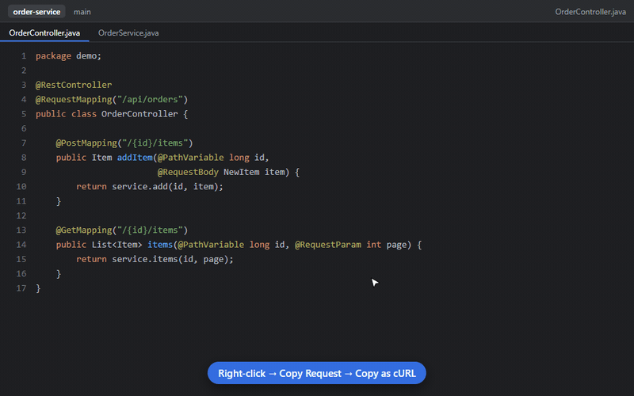
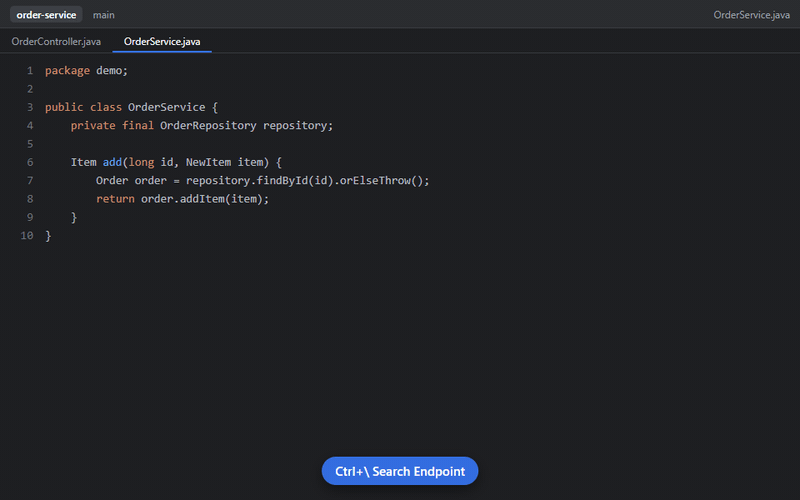
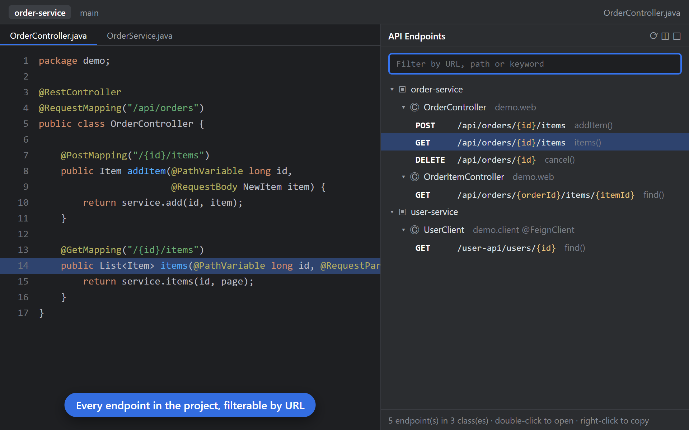

# hi-mamba · Feedback

问题反馈、功能建议、许可证和发布说明。**这里不放源码**，各软件的源码不公开。
Bug reports, feature requests, licenses and release notes. **Source code is not published here.**

👉 [**提交问题 / Report a bug**](https://github.com/hi-mamba/feedback/issues/new?template=bug.yml) · [**提建议 / Request a feature**](https://github.com/hi-mamba/feedback/issues/new?template=feature.yml) · [按软件查看 / Browse by product](https://github.com/hi-mamba/feedback/labels)

> ⚠️ Issue 是公开的，请不要粘贴公司代码、内网地址、令牌或密码。
> ⚠️ Issues are public. Do not paste company code, internal URLs, tokens or passwords.

## 软件 / Products

| 软件 / Product | 说明 / What it does | 安装 / Install | 文档 / Docs |
|---|---|---|---|
|  **API Request Copier** | 在 Spring 接口方法上右键，复制成能直接运行的 cURL / Postman / HTTP 请求；粘贴网址找到接口 · Right-click a Spring controller method to copy a ready-to-run cURL; paste a URL to find its endpoint | [JetBrains](https://plugins.jetbrains.com/plugin/35247-api-request-copier) · [VS Code](https://marketplace.visualstudio.com/items?itemName=hi-mamba.api-request-copier) | [更新日志 / Changelog](api-request-copier/CHANGELOG.md) · [许可证 / License](api-request-copier/LICENSE.txt) |
| **AI Commit Writer** | 用你自己的 AI 接口，从暂存区改动生成 Conventional Commits 提交信息 · Generate Conventional Commits messages from your staged diff with your own AI endpoint | [JetBrains](https://plugins.jetbrains.com/plugin/32528-ai-commit-writer) · [VS Code](https://marketplace.visualstudio.com/items?itemName=hi-mamba.hi-mamba-ai-commit-writer) | [隐私 / Privacy](ai-commit-writer/PRIVACY.md) · [许可证 / License](ai-commit-writer/LICENSE-JetBrains.txt) |
| **Dev Toolbox** | 10 合 1 本地开发工具箱 · 10-in-1 local developer toolbox | [Chrome](https://chromewebstore.google.com/detail/dev-toolbox/lfgjemggkbhoolgmcikfmbdmnlikkmio) | |
| **Timestamp Converter** | Unix 时间戳与日期互转 · Unix timestamp ↔ date | [Chrome](https://chromewebstore.google.com/detail/imeihmhhkoofnbjgogddeplgnkbkopok) | |

## API Request Copier

**右键复制成 cURL / Right-click → copy as cURL**

**粘贴网址找到接口 / Paste a URL → jump to the method**

**接口列表侧边栏 / Every endpoint in a sidebar**

## 隐私 / Privacy

这些工具都在你的电脑上本地运行，不统计、不追踪。反馈只在你主动提交 issue 时才会发出。
These tools run locally with no analytics or tracking. Feedback is only sent when you open an issue yourself.

More tools: [github.com/hi-mamba](https://github.com/hi-mamba)
